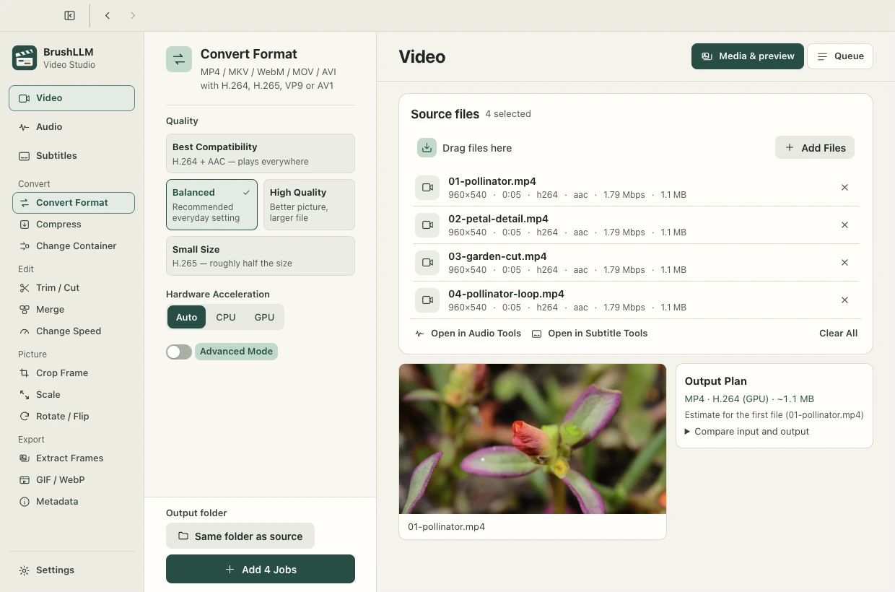

# BrushLLM Video Studio

Kostenlose Desktop-Werkzeuge für Video, Audio und Untertitel. Dateien werden lokal verarbeitet und lassen sich mit denselben Einstellungen stapelweise bearbeiten. FFmpeg und FFprobe sind enthalten.

[Aktuelle Version](https://github.com/BrushLLM/brushllm-video-studio/releases/latest) · [Produktseite](https://brushllm.com/de/video-studio/)

[English](../README.md) | [Deutsch](README.de.md) | [Español](README.es.md) | [Français](README.fr.md) | [Português (Brasil)](README.pt-BR.md) | [日本語](README.ja.md) | [简体中文](README.zh-CN.md) | [繁體中文](README.zh-TW.md) | [한국어](README.ko.md)



[Warteschlange ansehen](../.github/assets/queue.svg) · Vorschaumaterial aus dem [MDN CC0 flower sample](https://interactive-examples.mdn.mozilla.net/media/cc0-videos/flower.mp4).

## Funktionen

- **Video** — MP4, MKV, WebM, MOV und AVI umwandeln und komprimieren. Clips schneiden, drehen, skalieren, beschneiden, kompatible Clips verlustfrei verbinden und Einzelbilder oder Animationen exportieren.
- **Audio** — Audio umwandeln und schneiden, Lautstärke und Lautheit anpassen sowie Audiospuren aus Videos extrahieren oder ersetzen.
- **Untertitel** — SRT, VTT, ASS, SSA und TTML umwandeln, Zeiten verschieben und Zeichenkodierungen korrigieren. Textspuren extrahieren und Untertitel einbetten oder einbrennen.
- **Warteschlange** — Mehrere Dateien importieren, Ausgabe prüfen und Fortschritt verfolgen. Aufträge in der Warteschlange pausieren, abbrechen oder wiederholen und Ergebnisse und Fehler einsehen.

## Download

In der aktuellen Version steht das Installationspaket für die Architektur Ihres Geräts bereit.

| Plattform | Installationsdatei |
| --- | --- |
| macOS 12+ (Apple Silicon) | `BrushLLM.Video.Studio-<version>-arm64.dmg` |
| Windows x64 (Intel / AMD) | `BrushLLM.Video.Studio-<version>-x64.exe` |
| Windows ARM64 | `BrushLLM.Video.Studio-<version>-arm64.exe` |

`SHA256SUMS` enthält die Prüfsummen aller drei Dateien. Die macOS-Version ist nicht notarisiert und die Windows-Installationsdateien sind unsigniert.

## Oberflächensprachen

English · Deutsch · Español · Français · Português (Brasil) · 日本語 · 简体中文 · 繁體中文 · 한국어

## Lokal entwickeln

Node.js 24 LTS verwenden. Der Entwicklungsbefehl startet Vite und Electron zusammen.

```bash
npm ci
npm run fetch-binaries
npm run dev
```

`npm test` führt Unit- und Integrationstests mit FFmpeg aus. `npm run build` und danach `npm start` starten die Produktionsoberfläche lokal.

## Lizenz

Der App-Quellcode steht unter MIT. Für FFmpeg und FFprobe gelten ihre jeweiligen Lizenzen. [MIT](../LICENSE) · [FFmpeg](media-engine/NOTICE.md)
