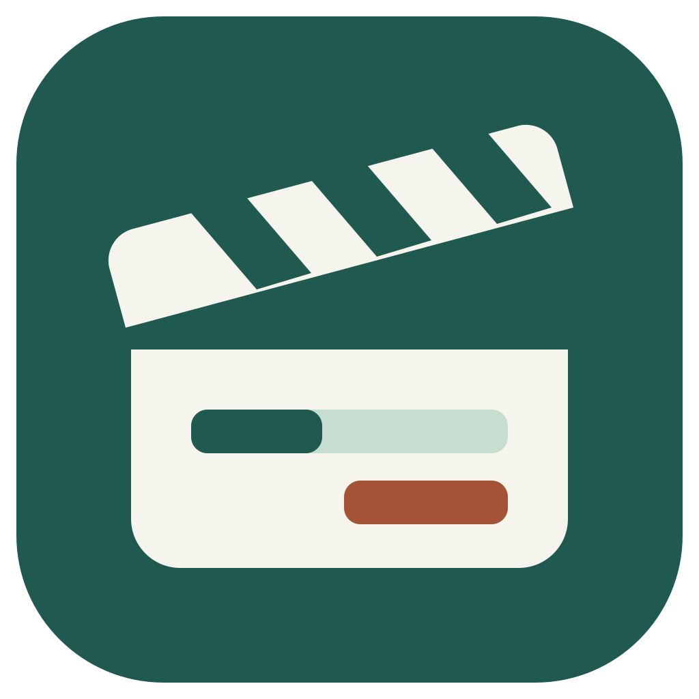

# BrushLLM Video Studio

동영상, 오디오, 자막을 위한 무료 데스크톱 도구입니다. 파일은 기기에서 처리하며 여러 파일에 같은 설정을 적용할 수 있습니다. FFmpeg와 FFprobe가 포함되어 있습니다.

[최신 릴리스](https://github.com/BrushLLM/brushllm-video-studio/releases/latest) · [제품 페이지](https://brushllm.com/ko/video-studio/)

[English](../README.md) | [Deutsch](README.de.md) | [Español](README.es.md) | [Français](README.fr.md) | [Português (Brasil)](README.pt-BR.md) | [日本語](README.ja.md) | [简体中文](README.zh-CN.md) | [繁體中文](README.zh-TW.md) | [한국어](README.ko.md)


[처리 대기열 보기](../.github/assets/queue.svg) · 미리보기 영상 출처 [MDN CC0 flower sample](https://interactive-examples.mdn.mozilla.net/media/cc0-videos/flower.mp4).

## 주요 기능

- **동영상** — MP4, MKV, WebM, MOV, AVI를 변환하고 압축합니다. 자르기, 크기 조정, 회전, 호환 클립 무손실 병합, 프레임과 애니메이션 내보내기를 지원합니다.
- **오디오** — 오디오를 변환하고 자르거나 볼륨과 라우드니스를 조절하고, 동영상에서 오디오 트랙을 추출하거나 교체합니다.
- **자막** — SRT, VTT, ASS, SSA, TTML을 변환하고 시간과 문자 인코딩을 수정합니다. 텍스트 트랙을 추출하거나 자막을 삽입하고 화면에 입힐 수 있습니다.
- **일괄 작업 대기열** — 여러 파일을 가져와 출력 설정과 진행 상황을 확인합니다. 대기열에서 일시 정지, 취소, 재시도를 하고 결과와 오류를 확인할 수 있습니다.

## 다운로드

최신 릴리스에서 기기에 맞는 설치 파일을 선택합니다.

| 지원 플랫폼 | 설치 파일 |
| --- | --- |
| macOS 12+ (Apple Silicon) | `BrushLLM.Video.Studio-<version>-arm64.dmg` |
| Windows x64 (Intel / AMD) | `BrushLLM.Video.Studio-<version>-x64.exe` |
| Windows ARM64 | `BrushLLM.Video.Studio-<version>-arm64.exe` |

`SHA256SUMS`에서 설치 파일 세 개의 체크섬을 확인할 수 있습니다. macOS 빌드는 공증되지 않았으며 Windows 설치 파일에는 서명이 없습니다.

## 인터페이스 언어

English · Deutsch · Español · Français · Português (Brasil) · 日本語 · 简体中文 · 繁體中文 · 한국어

## 로컬 개발

Node.js 22를 사용합니다. 개발 명령은 Vite와 Electron을 함께 실행합니다.

```bash
npm ci
npm run fetch-binaries
npm run dev
```

`npm test`는 단위 테스트와 실제 FFmpeg 통합 테스트를 실행합니다. `npm run build` 후 `npm start`로 배포용 화면을 확인합니다.

## 라이선스

앱의 소스 코드는 MIT 라이선스를 따릅니다. FFmpeg와 FFprobe에는 각각 원래 라이선스가 적용됩니다. [MIT](../LICENSE) · [FFmpeg](media-engine/NOTICE.md)
